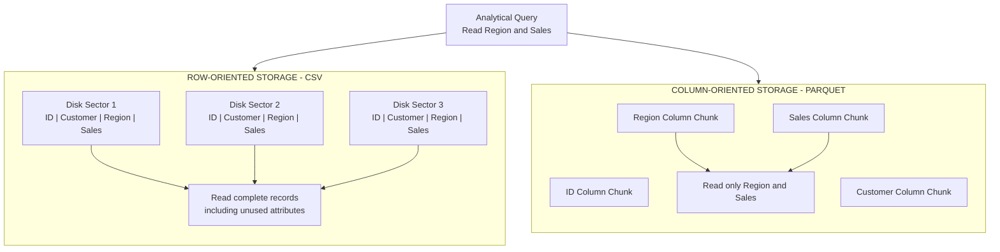

# Row-Oriented vs Column-Oriented Storage – Performance Comparison

## 1. Project Overview

This project demonstrates the differences between row-oriented and column-oriented data storage formats using Python, pandas, PyArrow, and Parquet.

The objective is to understand how different storage formats affect disk space, execution time, and memory consumption when performing data retrieval and analytical operations.

A synthetic e-commerce dataset containing **1 million records and 50 columns** was generated. The same dataset was stored in two different formats:

- **CSV:** Row-oriented storage format.
- **Apache Parquet:** Column-oriented storage format.

Performance experiments were conducted to compare storage size, full-row lookup performance, and single-column aggregation performance.

### Project Objectives

1. Generate a dataset containing at least 1 million rows and 50 columns.
2. Include mixed data types such as strings, integers, floating-point numbers, and Boolean values.
3. Store the dataset in CSV and Parquet formats.
4. Compare the total storage size of both formats.
5. Measure execution time and memory consumption for a full-row lookup using an ID.
6. Measure execution time and memory consumption for a single-column aggregation.
7. Understand the physical storage organization of row-oriented and column-oriented formats.
8. Understand the relationship between OLTP and OLAP workloads.

---

## 2. Technology Stack

| Technology         | Version | Purpose                             |
| ------------------ | ------- | ----------------------------------- |
| Python             | 3.14.3  | Programming language                |
| pandas             | 3.1.1   | Dataset generation and manipulation |
| PyArrow            | 26.0.1  | Parquet reading and writing         |
| NumPy              | 2.5.4   | Random data generation              |
| psutil             | 7.2.2   | Process memory measurement          |
| pip                | 26.3    | Python package management           |
| Visual Studio Code | -       | Code editor                         |
| Windows 11         | -       | Operating system                    |

---

## 3. Project Structure

```text
row-vs-column-assignment/
│
├── .venv/
│
├── data/
│   ├── raw/
│   │   └── ecommerce_1m.csv
│   │
│   └── processed/
│       └── ecommerce_1m.parquet
│
├── scripts/
│   ├── generate_dataset.py
│   ├── convert_to_parquet.py
│   └── benchmark_storage.py
│
├── .gitignore
├── requirements.txt
└── README.md
```

### Description of Important Files

| File                    | Description                                                                             |
| ----------------------- | --------------------------------------------------------------------------------------- |
| `generate_dataset.py`   | Generates the 1-million-row, 50-column e-commerce dataset.                              |
| `convert_to_parquet.py` | Converts the CSV dataset into Snappy-compressed Parquet format.                         |
| `benchmark_storage.py`  | Measures storage size, full-row lookup time, memory usage, and aggregation performance. |
| `ecommerce_1m.csv`      | Original row-oriented dataset.                                                          |
| `ecommerce_1m.parquet`  | Column-oriented Parquet dataset.                                                        |
| `requirements.txt`      | Contains the Python dependencies.                                                       |
| `README.md`             | Documents the complete assignment.                                                      |

---

# 4. Implementation Steps

## Step 1: Create the Project Directory

Created a separate project directory on the D drive.

Executed the following commands in Windows Command Prompt:

```cmd
mkdir D:\row-vs-column-assignment
cd /d D:\row-vs-column-assignment
```

This created the project directory and made it the current working directory.

## Step 2: Create and Activate a Python Virtual Environment

Created an isolated Python environment using:

```cmd
python -m venv .venv
```

Activated the environment:

```cmd
.venv\Scripts\activate
```

Verified the Python installation:

```cmd
python --version
```

Verified pip:

```cmd
python -m pip --version
```

**Environment details:**

- Python: 3.14.3
- pip: 25.3 initially, subsequently upgraded to 26.3.

A virtual environment keeps the project's dependencies isolated from other Python installations.

## Step 3: Install Required Dependencies

Installed the required Python libraries.

### Install pandas

```cmd
python -m pip install pandas
```

### Install PyArrow

```cmd
python -m pip install pyarrow
```

### Install psutil

```cmd
python -m pip install psutil
```

### Upgrade pip

```cmd
python -m pip install --upgrade pip
```

### Verify the installations

```cmd
python -c "import pandas as pd; import pyarrow as pa; import psutil; print('Pandas:', pd.__version__); print('PyArrow:', pa.__version__); print('Psutil:', psutil.__version__)"
```

**Installed versions:**

| Library | Version |
| ------- | ------- |
| pandas  | 3.1.1   |
| PyArrow | 26.0.1  |
| psutil  | 7.2.2   |
| NumPy   | 2.5.4   |

## Step 4: Create the Project Folders

Created the directories required for storing datasets and Python scripts.

```cmd
mkdir data
mkdir data\raw
mkdir data\processed
mkdir scripts
```

The folders serve the following purposes:

- `data/raw`: Stores the original CSV dataset.
- `data/processed`: Stores the converted Parquet dataset.
- `scripts`: Contains the Python implementation files.

### Create requirements.txt

Created a dependency file:

```cmd
notepad requirements.txt
```

Added the following dependencies:

```text
pandas==3.1.1
pyarrow==26.0.1
psutil==7.2.2
numpy==2.5.4
```

These dependencies can be installed together using:

```cmd
python -m pip install -r requirements.txt
```

---

# 5. Dataset Generation – 1 Million Rows and 50 Columns

## Step 5: Create the Sample Dataset

Created `scripts/generate_dataset.py`.

The script uses pandas and NumPy to generate a synthetic e-commerce dataset.

### Dataset Configuration

| Parameter       | Value                       |
| --------------- | --------------------------- |
| Total records   | 1,000,000                   |
| Total columns   | 50                          |
| Batch size      | 100,000                     |
| Output format   | CSV                         |
| Output location | `data/raw/ecommerce_1m.csv` |

### Column Distribution

The dataset contains mixed data types.

| Data Type      | Columns                                                                                                           |  Count |
| -------------- | ----------------------------------------------------------------------------------------------------------------- | -----: |
| String         | Product, Region, Category, Status, Payment Method, Customer Type, Sales Channel, Shipping Type, Priority, Country |     10 |
| Integer        | record_id, integer_1 to integer_20                                                                                |     21 |
| Boolean        | boolean_1 to boolean_10                                                                                           |     10 |
| Floating Point | float_1 to float_9                                                                                                |      9 |
| **Total**      |                                                                                                                   | **50** |

### Python Implementation

```python
import numpy as np
import pandas as pd
from pathlib import Path

# Dataset configuration
TOTAL_ROWS = 1_000_000
BATCH_SIZE = 100_000

OUTPUT_FILE = Path("data/raw/ecommerce_1m.csv")

OUTPUT_FILE.parent.mkdir(parents=True, exist_ok=True)

rng = np.random.default_rng(42)

# Sample string values
products = ["Laptop", "Mobile", "Tablet", "Monitor", "Keyboard"]
regions = ["North", "South", "East", "West"]
categories = ["Electronics", "Accessories", "Computers"]
statuses = ["Pending", "Shipped", "Delivered", "Cancelled"]
payment_methods = ["Card", "UPI", "Cash", "Net Banking"]

# Generate data in batches
for start in range(0, TOTAL_ROWS, BATCH_SIZE):

    rows = min(BATCH_SIZE, TOTAL_ROWS - start)

    data = {
        "record_id": np.arange(start + 1, start + rows + 1)
    }

    # 10 string columns
    data["product"] = rng.choice(products, rows)
    data["region"] = rng.choice(regions, rows)
    data["category"] = rng.choice(categories, rows)
    data["status"] = rng.choice(statuses, rows)
    data["payment_method"] = rng.choice(payment_methods, rows)
    data["customer_type"] = rng.choice(["New", "Returning"], rows)
    data["sales_channel"] = rng.choice(["Online", "Store"], rows)
    data["shipping_type"] = rng.choice(["Standard", "Express"], rows)
    data["priority"] = rng.choice(["Low", "Medium", "High"], rows)
    data["country"] = rng.choice(["India", "USA", "UK", "Canada"], rows)

    # 20 integer columns
    for i in range(1, 21):
        data[f"integer_{i}"] = rng.integers(1, 10000, rows)

    # 10 Boolean columns
    for i in range(1, 11):
        data[f"boolean_{i}"] = rng.choice([True, False], rows)

    # 9 floating-point columns
    for i in range(1, 10):
        data[f"float_{i}"] = np.round(
            rng.uniform(1, 100000, rows), 2
        )

    df = pd.DataFrame(data)

    # Append batches to CSV
    df.to_csv(
        OUTPUT_FILE,
        mode="w" if start == 0 else "a",
        header=(start == 0),
        index=False
    )

    print(
        f"Generated {start + rows:,} / {TOTAL_ROWS:,} records"
    )

    del df, data

print("\nDataset generation completed!")
print("Total rows:", TOTAL_ROWS)
print("Total columns:", len(pd.read_csv(OUTPUT_FILE, nrows=0).columns))
print("Output file:", OUTPUT_FILE)

print(
    "File size:",
    round(OUTPUT_FILE.stat().st_size / (1024 ** 2), 2),
    "MB"
)
```

### Execute the script

```cmd
python scripts\generate_dataset.py
```

### Actual Output

```text
Generated 100,000 / 1,000,000 records
Generated 200,000 / 1,000,000 records
Generated 300,000 / 1,000,000 records
Generated 400,000 / 1,000,000 records
Generated 500,000 / 1,000,000 records
Generated 600,000 / 1,000,000 records
Generated 700,000 / 1,000,000 records
Generated 800,000 / 1,000,000 records
Generated 900,000 / 1,000,000 records
Generated 1,000,000 / 1,000,000 records

Dataset generation completed!
Total rows: 1000000
Total columns: 50
Output file: data\raw\ecommerce_1m.csv
File size: 297.59 MB
```

### Observation

The dataset was successfully generated with 1 million records and 50 columns.

The generation process uses batches of 100,000 records to avoid holding the entire generated dataset in memory simultaneously.

The resulting CSV file occupies 297.59 MB.

---

# 6. Convert CSV into Apache Parquet

## Step 6: Create the Parquet Conversion Script

Created `scripts/convert_to_parquet.py`.

The purpose of this script is to convert the original CSV dataset into Apache Parquet format using PyArrow.

The conversion uses Snappy compression.

Since the dataset is relatively large, PyArrow's streaming CSV reader is used to process it in batches.

### Python Implementation

```python
import pyarrow as pa
import pyarrow.csv as csv
import pyarrow.parquet as pq
from pathlib import Path

# Input and output paths
input_file = Path("data/raw/ecommerce_1m.csv")
output_file = Path("data/processed/ecommerce_1m.parquet")

output_file.parent.mkdir(parents=True, exist_ok=True)

# Read CSV in batches
reader = csv.open_csv(
    input_file,
    read_options=csv.ReadOptions(
        block_size=16 * 1024 * 1024
    )
)

# Read the first batch
first_batch = reader.read_next_batch()

# Create Parquet writer
writer = pq.ParquetWriter(
    output_file,
    first_batch.schema,
    compression="snappy"
)

total_rows = 0

try:
    writer.write_batch(first_batch)
    total_rows += first_batch.num_rows

    print(f"Converted {total_rows:,} rows")

    # Write remaining batches
    for batch in reader:
        writer.write_batch(batch)
        total_rows += batch.num_rows

        print(f"Converted {total_rows:,} rows")

finally:
    writer.close()

# Compare file sizes
csv_size = input_file.stat().st_size
parquet_size = output_file.stat().st_size

print("\nConversion completed!")
print("----------------------")
print("Total rows:", total_rows)

print(
    "CSV size:",
    round(csv_size / (1024 ** 2), 2),
    "MB"
)

print(
    "Parquet size:",
    round(parquet_size / (1024 ** 2), 2),
    "MB"
)

print(
    "Storage reduction:",
    round((1 - parquet_size / csv_size) * 100, 2),
    "%"
)

print("\nParquet schema:")
print(pq.read_schema(output_file))
```

### Execute the script

```cmd
python scripts\convert_to_parquet.py
```

### Actual Output

```text
Converted 53,953 rows
Converted 107,846 rows
Converted 161,591 rows
Converted 215,331 rows
Converted 269,074 rows
Converted 322,825 rows
Converted 376,579 rows
Converted 430,325 rows
Converted 484,067 rows
Converted 537,811 rows
Converted 591,554 rows
Converted 645,304 rows
Converted 699,052 rows
Converted 752,799 rows
Converted 806,545 rows
Converted 860,291 rows
Converted 914,043 rows
Converted 967,793 rows
Converted 1,000,000 rows

Conversion completed!
Total rows: 1000000
CSV size: 297.59 MB
Parquet size: 123.63 MB
Storage reduction: 58.46 %
```

### Storage Comparison

| Storage Format   | File Size |
| ---------------- | --------: |
| CSV              | 297.59 MB |
| Parquet (Snappy) | 123.63 MB |
| Difference       | 173.96 MB |

**Storage reduction: 58.46%**

### Observation

The Parquet file is approximately 58.46% smaller than the CSV file.

This reduction is achieved through Parquet's columnar organization, data encoding, and Snappy compression.

The actual reduction depends on the dataset's values, data types, and compression settings.

---

# 7. Performance Benchmarking

## Step 7: Create the Benchmark Script

Created `scripts/benchmark_storage.py`.

This script compares CSV and Parquet using three main measurements:

1. Full-row lookup by ID.
2. Execution time and memory usage during the lookup.
3. Single-column aggregation across the entire dataset.

The benchmarking process uses pandas, PyArrow, Python's `time` module, and psutil.

### Experiment 1: Full-Row Lookup

The target record is:

```text
record_id = 750000
```

The objective is to retrieve the complete record containing all 50 attributes.

**CSV implementation:**

```python
def csv_lookup():
    df = pd.read_csv(CSV_FILE)

    matching_rows = df.loc[
        df["record_id"] == TARGET_ID
    ]

    result = (
        matching_rows.iloc[0].to_dict()
        if not matching_rows.empty
        else None
    )

    del df, matching_rows

    return result
```

The CSV implementation loads the complete dataset into a pandas DataFrame and filters it using the ID.

**Parquet implementation:**

```python
def parquet_lookup():
    dataset = ds.dataset(
        PARQUET_FILE,
        format="parquet"
    )

    table = dataset.to_table(
        columns=dataset.schema.names,
        filter=ds.field("record_id") == TARGET_ID
    )

    result = (
        table.slice(0, 1).to_pylist()[0]
        if table.num_rows > 0
        else None
    )

    del table

    return result
```

The Parquet implementation uses PyArrow's dataset filtering to retrieve the matching record.

Since the record IDs were generated in ascending order, Parquet's row-group statistics can help identify and skip irrelevant row groups.

## Experiment 2: Single-Column Aggregation

The second experiment calculates the average of:

```text
float_1
```

across all 1 million records.

**CSV implementation:**

```python
def csv_aggregation():
    df = pd.read_csv(
        CSV_FILE,
        usecols=["float_1"]
    )

    result = df["float_1"].mean()

    del df

    return result
```

The pandas `usecols` parameter ensures that only the required column is loaded.

**Parquet implementation:**

```python
def parquet_aggregation():
    table = pq.read_table(
        PARQUET_FILE,
        columns=["float_1"]
    )

    result = pc.mean(table["float_1"]).as_py()

    del table

    return result
```

The Parquet implementation reads only the required column using PyArrow.

## Experiment 3: Execution Time and Memory Measurement

The benchmark uses Python's `time.perf_counter()` to measure execution time.

The psutil library monitors process memory usage.

The following function is used to measure approximate peak memory increase and execution time:

```python
def measure_operation(operation):
    gc.collect()

    baseline_memory = process.memory_info().rss
    peak_memory = [baseline_memory]

    stop_monitoring = threading.Event()

    def monitor_memory():
        while not stop_monitoring.is_set():
            current_memory = process.memory_info().rss

            peak_memory[0] = max(
                peak_memory[0],
                current_memory
            )

            stop_monitoring.wait(0.01)

    monitor = threading.Thread(target=monitor_memory)
    monitor.start()

    start_time = time.perf_counter()

    try:
        result = operation()
    finally:
        elapsed = time.perf_counter() - start_time

        peak_memory[0] = max(
            peak_memory[0],
            process.memory_info().rss
        )

        stop_monitoring.set()
        monitor.join()

    memory_increase = max(
        0,
        peak_memory[0] - baseline_memory
    ) / (1024 ** 2)

    return result, elapsed, memory_increase
```

This function:

1. Runs garbage collection before the operation.
2. Records the baseline process memory.
3. Starts a separate monitoring thread.
4. Measures execution time.
5. Tracks the approximate peak process memory.
6. Returns the result, elapsed time, and memory increase.

**Note:** The memory measurement is an approximate process-level RSS increase sampled every 10 milliseconds. It is not an exact measurement of memory allocated exclusively by an individual query.

### Execute the benchmark

```cmd
python scripts\benchmark_storage.py
```

---

# 8. Actual Benchmark Results

The following results were obtained from the implemented experiments.

## A. File Storage Comparison

| Metric            |       CSV |   Parquet |
| ----------------- | --------: | --------: |
| File size         | 297.59 MB | 123.63 MB |
| Storage reduction |         - |    58.46% |

Parquet requires approximately 173.96 MB less storage than CSV.

## B. Full-Row Lookup Performance

**Lookup condition:** `record_id = 750000`

| Metric               |            CSV |        Parquet |
| -------------------- | -------------: | -------------: |
| Execution time       | 0.8843 seconds | 0.0500 seconds |
| Peak memory increase |      917.58 MB |       38.00 MB |
| Record found         |            Yes |            Yes |

### Performance Analysis

Parquet completed the full-row lookup approximately 17.68 times faster than CSV in this experiment.

Memory consumption was also significantly lower with Parquet.

The CSV implementation loaded the complete dataset before applying the filter.

The Parquet implementation used filtered reading and could benefit from row-group statistics to avoid reading unrelated row groups.

### Lookup Memory Reduction

Approximately 95.86% less peak memory increase was observed with Parquet.

## C. Single-Column Aggregation Performance

**Operation:** Calculate the average of `float_1`.

| Metric               |            CSV |        Parquet |
| -------------------- | -------------: | -------------: |
| Average              |      49,994.75 |      49,994.75 |
| Execution time       | 0.6500 seconds | 0.0969 seconds |
| Peak memory increase |       18.85 MB |        6.25 MB |

### Performance Analysis

Both formats produced exactly the same average.

However, Parquet completed the aggregation approximately 6.71 times faster.

It also used approximately 66.84% less peak memory increase.

The main advantage is that Parquet stores column values together, allowing the reader to retrieve only the required `float_1` column.

## D. Overall Performance Comparison

| Experiment                  |        CSV |    Parquet | Result  |
| --------------------------- | ---------: | ---------: | ------- |
| Storage size                |  297.59 MB |  123.63 MB | Parquet |
| Full-row lookup time        | 0.8843 sec | 0.0500 sec | Parquet |
| Lookup memory increase      |  917.58 MB |   38.00 MB | Parquet |
| Aggregation time            | 0.6500 sec | 0.0969 sec | Parquet |
| Aggregation memory increase |   18.85 MB |    6.25 MB | Parquet |

### Performance Improvement Summary

| Measurement                      | Parquet Advantage |
| -------------------------------- | ----------------: |
| Storage reduction                |            58.46% |
| Full-row lookup speed ratio      |            17.68× |
| Full-row lookup memory reduction |            95.86% |
| Aggregation speed ratio          |             6.71× |
| Aggregation memory reduction     |            66.84% |

**Important benchmarking limitation:**

These measurements represent the implemented Python and PyArrow workflows, not a universal comparison of every CSV and Parquet reader.

The CSV lookup loads all columns into pandas, whereas the Parquet lookup uses a filtered scan. Similarly, the aggregation reads only one column from both formats. File caching, filesystem behavior, and background processes can influence the results. Repeated runs would be needed for a more rigorous benchmark.

---

# 9. Technical Block Diagram – Row vs Column Storage

## A. Row-Oriented Storage (CSV)

In row-oriented storage, all attributes belonging to one record are stored together.

For example:

| ID  | Customer | Region | Sales |
| --- | -------- | ------ | ----: |
| 101 | Ashish   | North  |  5000 |
| 102 | Rahul    | South  |  3000 |
| 103 | Priya    | East   |  7000 |

Simplified physical layout:

```text
             ROW-ORIENTED STORAGE (CSV)

                    Disk Storage
                         |
              +----------+----------+
              |          |          |
              v          v          v
          Sector 1   Sector 2   Sector 3
              |          |          |
              v          v          v
          +---------------------------+
          | 101 | Ashish | North | 5000|
          +---------------------------+
          | 102 | Rahul  | South | 3000|
          +---------------------------+
          | 103 | Priya  | East  | 7000|
          +---------------------------+

        Each record stores all attributes together.

        Query: Read Region and Sales

        Unnecessary attributes such as ID and Customer
        may also need to be scanned.
```

### Explanation

When a query requests only Region and Sales, a row-oriented format may still require scanning complete records to extract those attributes.

This can increase unnecessary data reading for analytical queries involving only a few columns.

## B. Column-Oriented Storage (Parquet)

In column-oriented storage, values belonging to the same attribute are stored together within column chunks.

Using the same example:

```text
             COLUMN-ORIENTED STORAGE (PARQUET)

                     Disk Storage
                          |
          +---------------+---------------+
          |               |               |
          v               v               v
      ID Chunk      Customer Chunk   Region Chunk
          |               |               |
       101,102,103   Ashish,Rahul,Priya North,South,East

                          |
                          v
                      Sales Chunk
                          |
                       5000,3000,7000


             Query: Read Region and Sales

                   +-------------+
                   | Region      |
                   | Sales       |
                   +-------------+

              Only required columns are read.

              ID and Customer chunks can be skipped.
```

### Explanation

Parquet organizes data by columns, allowing query engines to read only the attributes required for a particular operation.

For example, when calculating total sales by region, the reader can access only the Region and Sales columns.

This reduces unnecessary disk I/O, memory consumption, and data processing.

**Technical clarification:** These diagrams represent logical storage organization. They do not mean that each row or column chunk occupies exactly one physical disk sector. Actual physical placement is managed by the filesystem and storage device.

## C. Mermaid Technical Block Diagram

The following diagram provides a visual comparison of both storage formats.



---

# 10. Conceptual Summary – OLTP vs OLAP

### Row-Based vs Column-Based Storage

Row-based and column-based storage formats are designed for different types of database workloads.

Row-oriented storage keeps all attributes of a record together. This makes it efficient for Online Transaction Processing (OLTP), where applications frequently perform CRUD operations (Create, Read, Update, Delete). For example, when an application inserts a new customer or updates an existing order, the database can access and modify the complete record efficiently without reorganizing an entire column.

Column-oriented storage organizes values belonging to the same attribute together. This makes it particularly suitable for Online Analytical Processing (OLAP), where queries frequently calculate aggregations, averages, sums, and statistics across large datasets. Analytical queries can read only the required columns instead of scanning every attribute, reducing disk I/O and memory consumption.

Another advantage of columnar storage is improved compression. Values within a column generally share the same data type and often contain repetitive patterns. This uniformity allows encoding and compression techniques such as dictionary encoding, run-length encoding, and bit packing to reduce storage requirements.

In this assignment, Parquet achieved a 58.46% smaller file size, a 17.68-times faster full-row lookup, and a 6.71-times faster single-column aggregation than the tested CSV implementation. These results demonstrate why columnar storage is highly effective for analytical workloads, while row-oriented storage remains useful for transactional applications.

---

# 11. Key Concepts Learned

| Concept                 | Explanation                                                                  |
| ----------------------- | ---------------------------------------------------------------------------- |
| Row-Oriented Storage    | Stores all attributes of a record together.                                  |
| Column-Oriented Storage | Stores values belonging to the same column together.                         |
| CSV                     | Text-based tabular format commonly organized by records and fields.          |
| Apache Parquet          | Columnar binary storage format designed for analytical processing.           |
| OLTP                    | Online Transaction Processing involving frequent transactional operations.   |
| OLAP                    | Online Analytical Processing involving large-scale queries and aggregations. |
| CRUD                    | Create, Read, Update, and Delete operations.                                 |
| Column Pruning          | Reading only the columns required by a query.                                |
| Compression             | Reducing the physical storage required for data.                             |
| Predicate Pushdown      | Applying filters during data scanning where supported.                       |
| Row Group               | Horizontal subset of rows stored in a Parquet file.                          |
| Column Chunk            | Data for one column within a Parquet Row Group.                              |
| Page                    | Basic unit of Parquet column data storage and encoding.                      |

---

# 12. How to Run the Complete Project

After setting up the virtual environment and installing the dependencies, execute the following commands in order.

### 1. Activate the environment

```cmd
.venv\Scripts\activate
```

### 2. Generate the dataset

```cmd
python scripts\generate_dataset.py
```

### 3. Convert CSV into Parquet

```cmd
python scripts\convert_to_parquet.py
```

### 4. Execute the performance benchmark

```cmd
python scripts\benchmark_storage.py
```

The scripts generate the required datasets and print the actual performance measurements.

---

# 13. Final Project Outcome

The row-oriented vs column-oriented storage assignment was successfully implemented.

The project demonstrates:

- Generated a dataset containing 1 million records and 50 columns.
- Used mixed data types including strings, integers, floating-point numbers, and Boolean values.
- Stored the dataset in CSV and Apache Parquet formats.
- Reduced file storage size by 58.46% using Snappy-compressed Parquet.
- Measured full-row lookup execution time and memory consumption.
- Measured single-column aggregation execution time and memory consumption.
- Compared both storage formats using actual Python benchmarks.
- Created a technical block diagram explaining row and column storage layouts.
- Studied OLTP and OLAP workloads and their storage requirements.

### Final Results

| Parameter                   | Result    |
| --------------------------- | --------- |
| Dataset rows                | 1,000,000 |
| Dataset columns             | 50        |
| CSV file size               | 297.59 MB |
| Parquet file size           | 123.63 MB |
| Storage reduction           | 58.46%    |
| Full-row lookup speed ratio | 17.68×    |
| Aggregation speed ratio     | 6.71×     |

**Final Conclusion:**

The experiment demonstrates that Apache Parquet provides significant storage and analytical-query advantages in the tested workload. CSV remains a convenient text-based format for data exchange and record-oriented workflows, while Parquet is particularly suitable for analytical processing where queries frequently access selected columns from large datasets.

---

**Assignment Status: Successfully Implemented**
